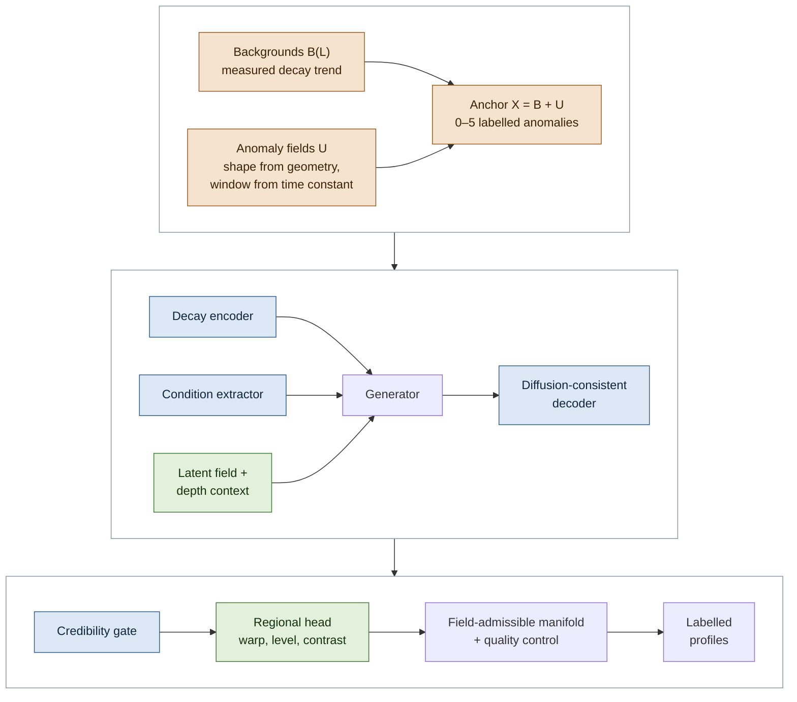

# STRATA

[](https://github.com/YYALD/STRATA/actions/workflows/ci.yml)

**STRATA: jointly decay- and profile-constrained generation of borehole transient electromagnetic data for anomaly
identification under data scarcity**

## Overview

STRATA generates labelled borehole transient electromagnetic (TEM) profiles from a few measured ones. A generated
profile $\mathbf{X}$ ($N$ stations × $T$ gates) lies on a joint decay–profile manifold,

$$\mathcal{M}_2 = \left\lbrace \mathbf{X} = \mathbf{B} + \mathbf{U} : X_{i,j+1} \le X_{i,j},\ \mathbf{B} \in
\mathcal{B}(\mathbf{L}),\ \mathbf{U} \in \mathcal{U} \right\rbrace,$$

where $\mathcal{B}(\mathbf{L})$ are along-hole backgrounds derived from the measured profile $\mathbf{L}$ and
$\mathcal{U}$ anomaly fields of conductors near the hole. Every generated profile starts from an anchor, the measured
decay trend with synthetic anomalies drawn under physical priors; a network trained against critics of measured data
then deforms only the background of the anchor, so each anomaly keeps the depth, shape and amplitude of its label. The
constraints act in time (decay manifold: the decay features of the physical diffusion process are preserved, and
every background decay is tested against the measured decays), along the hole (profile manifold: a latent field
correlates the deformation from station to station, an order-preserving warp keeps the rock units in order, a critic
judges profile windows) and across the two (an anomaly takes its along-hole shape from the geometry of its conductor
and its time window from the conductor's time constant).

This repository holds the generator (`main.py` and the `strata` package) and one standalone program for each
comparison generator (`methods/`). The field data of the manuscript are not included; the programs run on your own
profiles or on the synthetic example in `examples/`.

## Key Features

- **Joint decay–profile (space–time) manifold constraint**: the measured profile is split into a smooth decay trend
  in time and along the hole and its departures; anchor backgrounds change the level, decay rate and along-hole
  contrast of the trend and keep the decay features of the diffusion process (a running minimum over time). 0–5
  anomalies per
  profile are added as conductors cut by the hole (a Gaussian footprint that widens with time), conductors beside it
  (a tilted dipole field), near-hole zones or measured-like shapes from a shape bank (departures of the input,
  simulated conductors and shapes of a β-VAE), each with a time envelope set by the conductor's time constant. The
  drawn anomalies are the labels.
- **Decay-manifold-constrained feature extraction (in time)**: each decay of the anchor is encoded with its
  condition, a diffusion-consistent decoder preserves the decay features of the physical diffusion process in every
  decoded decay, and a credibility gate moves decoded decays whose conditions leave the manifold of the anchor
  conditions back toward it.
- **Profile-manifold-constrained feature extraction (along the hole)**: a latent field and a depth context along the
  hole correlate the deformation from station to station, and a regional head reduces it to an order-preserving warp,
  a level and a contrast of the background, so each anomaly keeps the depth, shape and amplitude of its label.
- **Three critics**: latent sequences, single decays and profile windows; staged training and an exponential moving
  average of the generator.
- **Admissibility and quality control**: a field-admissible manifold of the measured decays, background purity, warp
  content and anomaly retention; a failing profile is regenerated with its labels unchanged, and an audit compares the
  accepted labels with the drawn ones.
- **Comparison generators**: GAN-T, CGAN-T, GAN-P, CGAN-P, DDPM-P and CDDPM-P, each a standalone program.

## Project Structure

```
STRATA/
├── main.py                        # entry point of the generator (menus and command line)
├── strata/                        # the STRATA generator (PyTorch)
│   ├── data/                      # measured-anchored data contract
│   │   ├── readers.py             # readers of measured profiles and survey line files
│   │   ├── time_grid.py           # anchored time grid, PCHIP resampling
│   │   ├── extension.py           # stations and times without a measurement
│   │   ├── contract.py            # measured and simulated data objects
│   │   └── normalization.py       # adaptive normalisation
│   ├── manifold/                  # manifold constraints
│   │   ├── joint.py               # joint decay–profile (space–time) manifold: B and U
│   │   ├── decay.py               # decay-manifold-constrained feature extraction (in time)
│   │   └── profile.py             # profile-manifold-constrained feature extraction (along the hole)
│   ├── models/
│   │   ├── generator.py           # latent generator and supervisor
│   │   ├── critics.py             # critics of latent sequences and single decays
│   │   ├── layers.py              # building blocks
│   │   └── baselines.py           # DCGAN-1D of the GAN / CGAN ablation baselines
│   ├── morphology.py              # anomaly-morphology prior: shape bank and β-VAE
│   ├── physics.py                 # TEM physics descriptor, field-admissible manifold
│   ├── trainer.py                 # anchors, regional head, staged training, generation
│   ├── losses.py                  # training losses
│   ├── quality.py                 # quality metrics and QC gates
│   ├── export.py                  # output files and QC split
│   ├── pipeline.py                # data contract of a run
│   ├── validation.py              # cross-validation along the hole
│   ├── evidence.py                # evidence for the decomposition and the generated set
│   ├── ablation.py                # single-factor ablations
│   ├── figures.py                 # figures and printed reports
│   ├── checkpoints.py             # checkpoint files
│   ├── config.py                  # configuration
│   ├── cli.py                     # command line
│   ├── session.py                 # menus and session runner
│   └── common.py                  # shared helpers
├── methods/                       # comparison generators, one program each
│   ├── common.py                  # readers, layout sampler, network blocks, command line
│   ├── gan_t.py                   # GAN-T
│   ├── cgan_t.py                  # CGAN-T
│   ├── gan_p.py                   # GAN-P
│   ├── cgan_p.py                  # CGAN-P
│   ├── ddpm_p.py                  # DDPM-P
│   └── cddpm_p.py                 # CDDPM-P
├── examples/
│   └── make_synthetic_profile.py  # synthetic test profile
├── tests/                         # pytest suite (no field data needed)
├── requirements.txt
└── LICENSE
```

## File Descriptions

### Generator

- **`main.py`**: the entry point. It runs from menus or from command-line flags and reports itself as RFMG-Gen
  22.2.0.
- **`strata/data/`**: the data contract; the measured gates and depths are the time and depth standard.
- **`strata/manifold/`**: the three manifold constraints of the architecture (below): `joint.py` the joint
  decay–profile manifold (the decomposition into decay trend and departures, and the laws of the anomaly fields),
  `decay.py` the networks constrained in time, `profile.py` those constrained along the hole.
- **`strata/models/`**: the other networks: `generator.py` the generator and its supervisor, `critics.py` the critics
  of latent sequences and single decays.
- **`strata/morphology.py`**: the shape bank and its β-VAE.
- **`strata/trainer.py`**: anchors, the regional head, staged training and generation.
- **`strata/physics.py`**, **`strata/quality.py`**, **`strata/export.py`**: the field-admissible manifold, quality
  control and the export of labelled profiles.
- **`strata/validation.py`**: the cross-validation along the hole.
- The other modules hold the menus and the session runner (`session.py`), the command line (`cli.py`), the
  configuration (`config.py`), the data contract of a run (`pipeline.py`), checkpoints, figures, losses, ablations and
  evidence.

### Comparison methods

| Program | Method | Design |
|:--|:--|:--|
| `methods/gan_t.py` | GAN-T | WGAN-GP on single decays; the generated decays are placed at the stations in the rank order of the training profile |
| `methods/cgan_t.py` | CGAN-T | conditional GAN on single decays, given depth and anomaly weight |
| `methods/gan_p.py` | GAN-P | convolutional WGAN-GP on 64-point (126 m) depth windows on a 2 m grid |
| `methods/cgan_p.py` | CGAN-P | image-to-image conditional GAN (pix2pix): 1-D U-Net from the anomaly-weight map and depth, PatchGAN critic, L1 term |
| `methods/ddpm_p.py` | DDPM-P | denoising diffusion on depth windows (cosine schedule, 1000 steps, moving-average weights), DDIM sampling in 50 steps |
| `methods/cddpm_p.py` | CDDPM-P | DDPM-P conditioned on the anomaly-weight map and depth |

Each program trains on one profile and generates profiles on its stations. The conditional methods (CGAN-T,
CGAN-P, CDDPM-P) generate one profile per drawn anomaly layout, which is its label.

### Examples and tests

- **`examples/make_synthetic_profile.py`**: writes a synthetic profile (`profile.csv`), its gate times
  (`gate_times.csv`) and its anomalies (`events.json`) in the layout the programs read.
- **`tests/`**: the command lines, the generator loaded by path as the comparison programs load it, the
  diffusion-consistent decoder, and the training, generation and output files of every comparison program.

## Installation

### Requirements

- Python 3.10 or later
- PyTorch 2.7 or later; a CUDA GPU for training at full size (NVIDIA RTX 50-series GPUs need the CUDA 12.8 build)

```bash
git clone https://github.com/YYALD/STRATA.git
cd STRATA
# for a GPU, first install the PyTorch build that matches your CUDA, for example
#   pip install --index-url https://download.pytorch.org/whl/cu128 "torch>=2.7"
pip install -r requirements.txt
python -m pytest -q
```

Tested on a CPU under Windows 11 with Python 3.14.0 (PyTorch 2.12.0, NumPy 2.3.4, pandas 3.0.3, Matplotlib 3.10.7)
and Python 3.10.11 (PyTorch 2.9.0, NumPy 2.2.6, pandas 2.3.3, Matplotlib 3.10.7).

### Dependencies

- **PyTorch**: networks and training
- **NumPy** and **pandas**: arrays and tables
- **Matplotlib**: figures
- **pytest**: tests

## Usage

### 1. Check the installation

```bash
python main.py --smoke_test
```

The self-check runs the whole generator at tiny settings on built-in synthetic data in a temporary folder and ends
with `RFMG_GEN_SELF_CHECK_PASS`; the quality-control status it prints on the way can read `FAIL` at these settings.
On eight CPU threads it takes about 50 min, most of it for training the β-VAE of the shape bank.

### 2. Generate profiles

```bash
python examples/make_synthetic_profile.py            # writes examples/data/; or use your own profile
python main.py --train_action restart --run_scope full --ablation full --survey_mode borehole \
    --real_data_file examples/data/profile.csv \
    --model_dir runs/strata/model --generated_data_path runs/strata/output
```

`--run_scope test` trains on a short schedule. Without flags, `main.py` asks for the run scope, the ablation, the
survey type and the checkpoint action in menus.

**Input.** A measured profile as a CSV table with a station column (depth in m) and one column per gate
(`STATION, CH1, ..., CHn`; positive amplitudes), and its gate times in a CSV in the same folder whose name contains
`gate` and `time` (or `--gate_time_file`). A matrix with depth in the first column and the gate times in the header
row is read as well. A simulated profile of the hole (`--simulata_data_file`) serves as a structural prior, its
conductors entering the shape bank; without it the run uses the measured profile only.

**Main options.**

| Option | Meaning |
|:--|:--|
| `--capacity_profile {baseline,enhanced,high,large,xl}` | network size (default `baseline`) |
| `--generated_profile_count N` | number of generated profiles (default 1000) |
| `--seed N` | random seed (default 42) |
| `--ablation MODE` | one mechanism ablation, or a comma list run as a batch |
| `--cv_folds K` | leave-block-out cross-validation along the hole (0 = off) |
| `--train_action {restart,resume,auto,generate_only}` | train anew, resume from the latest checkpoint, resume when one exists, or generate with a trained model |
| `--visualization {all,pca,tsne,none}` | figures of the run, with the feature-space view by PCA, t-SNE or both (`none`: no figures) |

`python main.py --help` lists the common options.

**Output.** `--generated_data_path` receives the generated profiles (`generated_profiles.csv`,
`generated_decay_curves.csv`; as an array in `generated_profiles_float32.npy` with its axes in `generated_axes.npz`)
and their labels (`generated_profile_index.csv`: the anomalies of every profile with depth, width, amplitude, time
constant and kind); `--model_dir` receives the checkpoints (`checkpoints/final.pt`), the reports
(`analysis/reports/`, with the quality control and the label audit in `generation_metrics.json`) and the figures.

### 3. Run a comparison method

```bash
python methods/gan_p.py  --profile examples/data/profile.csv --gates examples/data/gate_times.csv --out runs/gan_p
python methods/cgan_p.py --profile examples/data/profile.csv --events examples/data/events.json --out runs/cgan_p
```

| Option | Meaning |
|:--|:--|
| `--profile` | training profile (CSV: depth, then one column per gate) |
| `--gates` | gate times (CSV), stored with the output |
| `--events` | anomalies of the training profile (JSON list of `centre_m`, `sigma_m`); required by CGAN-T, CGAN-P and CDDPM-P |
| `--stations` | output depths (first column of a CSV); default: the stations of the training profile |
| `--iters` | training iterations (default 4000; 20000 for DDPM-P and CDDPM-P) |
| `--n_profiles` | profiles to generate (default 1000) |
| `--seed`, `--device`, `--threads`, `--out` | seed, `auto` / `cpu` / `cuda`, CPU threads, output folder |

A run writes `profiles_raw.npz` (`L`: log10 amplitude, profiles × stations × gates; `depth_m`; `gate_ms`),
`profiles_native.npz` (profile methods: the 2 m grid), `layouts.json` (conditional methods: the anomaly layout of
every profile), `generator.pt` and `run.json`.

## Model Architecture



Orange: joint decay–profile (space–time) manifold; blue: decay-manifold-constrained feature extraction (in time);
green: profile-manifold-constrained feature extraction (along the hole). Critics of latent sequences, single decays
and profile windows train the network.

The STRATA architecture consists of (files in `strata/`):

1. **Joint decay–profile (space–time) manifold** (`manifold/joint.py`: `background_decomposition`,
   `measured_trend_undulations`, `borehole_physical_anomalies`, `dipole_axial_kernel`; `trainer.py`:
   `RFMGGenTrainer.compose_anchor`)
   - **Backgrounds $\mathcal{B}(\mathbf{L})$**: the log amplitude of the measured profile is split into a decay trend,
     smooth in time and along the hole, and the departures from it; a background is the trend with its level, decay
     rate and contrast changed, keeping the decay features of the diffusion process (a running minimum over time).
   - **Anomaly fields $\mathcal{U}$**: relative response changes whose along-hole shape follows the geometry of the
     conductor (or the shape bank) and whose time window follows its time constant; they are the labels.
   - **Anchor**: $\mathbf{X} = \mathbf{B} + \mathbf{U}$ with the decay features of the diffusion process preserved;
     the network below changes only its background.

2. **Decay-manifold-constrained feature extraction, in time** (`manifold/decay.py`: `Embedder`,
   `TEMConditionExtractor`, `Recovery`, `_FinCMG`)
   - **Decay encoder**: two Transformer layers and a long short-term memory (LSTM) network map each decay of the
     anchor to a latent sequence; a direct value path keeps the amplitude of every gate.
   - **Condition extractor**: time, frequency and shape features in InceptionTime and Transformer streams give the
     condition of each decay.
   - **Diffusion-consistent decoder**: the decoder outputs a start level and gate-by-gate decay increments, which
     preserves the decay features of the physical diffusion process; a skip connection returns the anchor when the
     latent sequence is unchanged.
   - **Credibility gate**: the condition of a decoded decay that lies beyond a learned radius of the manifold of the
     anchor conditions (a memory bank) is moved toward its projection on it, and the decoded effect of the move
     corrects the decay; within the radius the decay stays nearly unchanged.

3. **Profile-manifold-constrained feature extraction, along the hole** (`manifold/profile.py`:
   `depth_latent_field`, `ProfileDepthContext`, `ProfilePatchDiscriminator`; `trainer.py`:
   `RFMGGenTrainer._warp_background`)
   - **Latent field and depth context**: random Fourier features of depth and a bidirectional gated recurrent unit
     (GRU) over the stations correlate the deformation from station to station.
   - **Regional head**: the network's change of the background is reduced to a warp along the hole (three sine
     terms; the warped depth stays strictly increasing, so rock units keep their order), a level and a contrast at
     each time sample; the anomalies keep their depths, shapes and amplitudes.
   - **Profile critic**: judges windows of neighbouring stations.

4. **Generator** (`models/generator.py`: `BridgeResidualGenerator`, `Supervisor`): bidirectional LSTMs with
   feature-wise linear modulation (FiLM) on the anchor condition, cross-attention and a residual path on the anchor
   latent; the supervisor learns the latent dynamics.

5. **Critics and training** (`models/critics.py`: `ConditionalDiscriminator`, `SequencePatchDiscriminator`;
   `manifold/profile.py`: `ProfilePatchDiscriminator`; `trainer.py`: `RFMGGenTrainer`): critics of latent sequences,
   single decays and profile windows (minibatch standard-deviation features, non-saturating loss with an R1 penalty);
   stages from an autoencoder of single decays through the supervisor and a pretraining of the generator to
   adversarial training; generation with an exponential moving average of the generator.

6. **Field-admissible manifold and quality control** (`physics.py`: `FieldAdmissibleManifold`, `PhysicsDescriptor`;
   `export.py`: `export_qc_split`): ten features of each background decay are tested against the manifold of the
   measured decays (95% of a profile's background decays inside); background purity, warp content, roughness, a
   physics envelope and the retention of every labelled anomaly sort the profiles into accepted, review and rejected
   sets; a failing profile is regenerated up to eleven times from new latent vectors.

## Citation

If you use this code, please cite the accompanying article:

*Jointly decay- and profile-constrained generation of borehole transient electromagnetic data for anomaly
identification under data scarcity.*

## License

This project is licensed under the MIT License; see [LICENSE](LICENSE).

## Contact

For questions or problems, please open an issue on GitHub.
